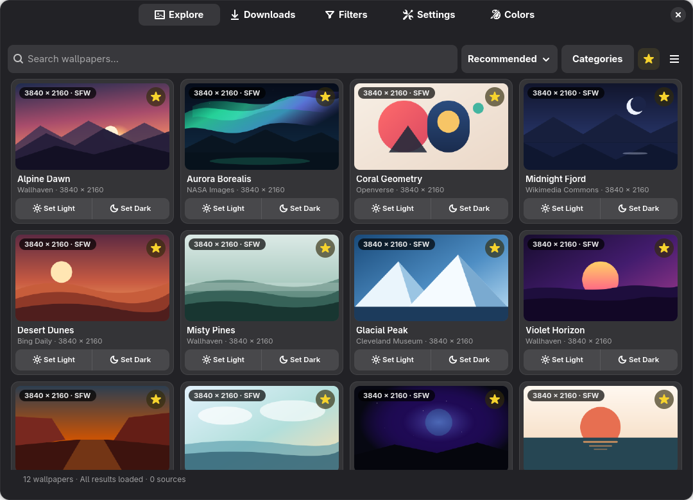
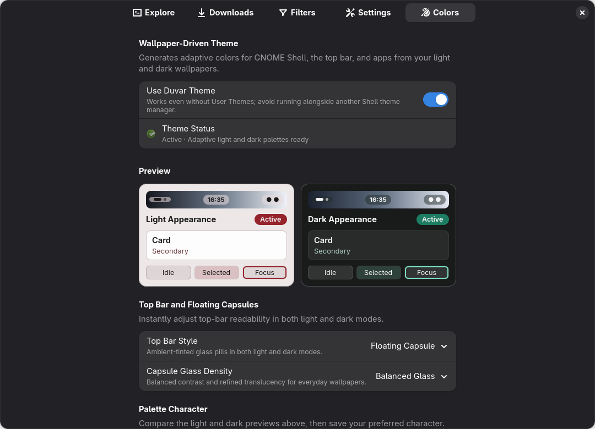
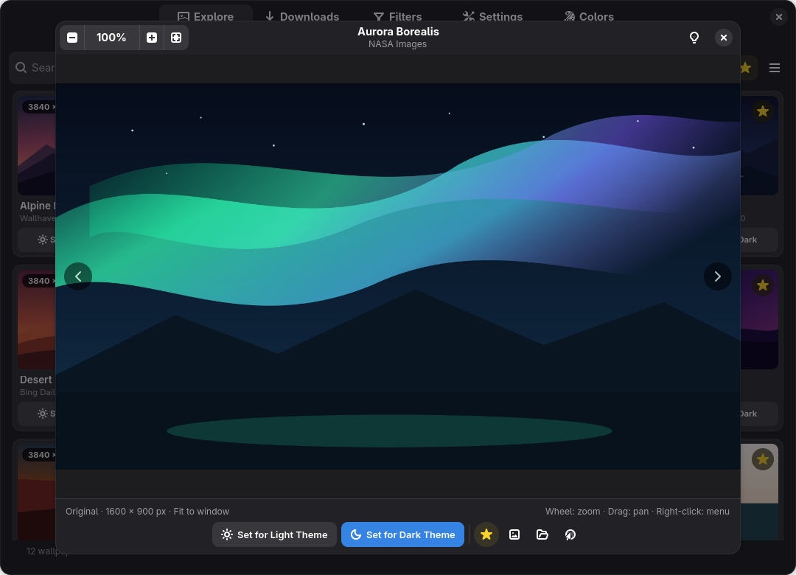
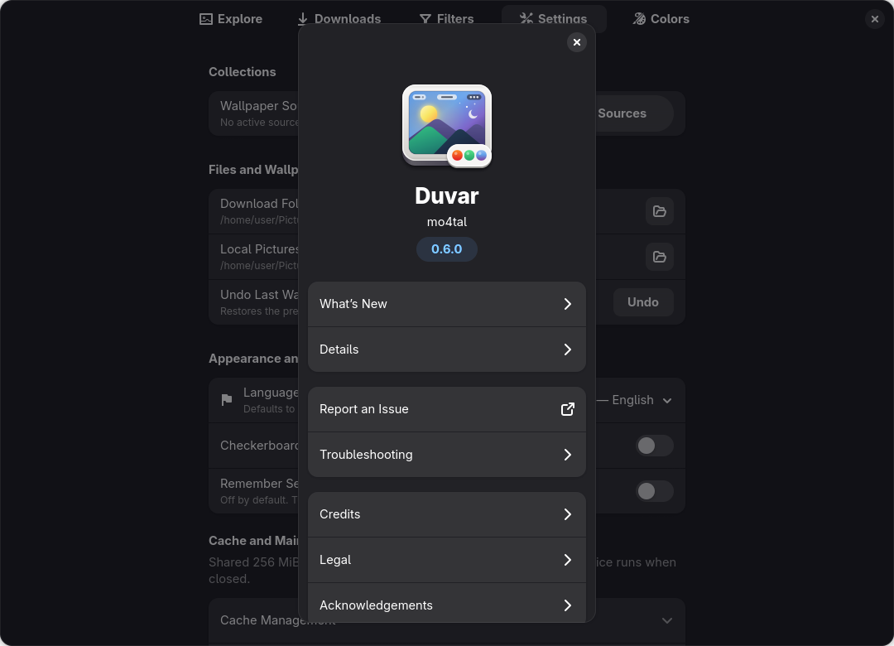

<div align="center">

<a href="https://github.com/mo4tal/duvar">
  
</a>

<br /><br />

**English** · [**Türkçe**](README.tr.md)

<br />

[](https://github.com/mo4tal/duvar/actions/workflows/ci.yml)
[](https://github.com/mo4tal/duvar/releases)
[](https://extensions.gnome.org/)
[](Cargo.toml)
[](locales/README.md)
[](LICENSE)

<br />

[Quick Install](#-quick-install) · [Recommended Desktop Setup](#-recommended-gnome-desktop-bundle) · [Features](#-highlights) · [Sources](#-12-official-sources) · [Languages](#-10-built-in-languages) · [Build from Source](#-build-from-source)

</div>

<br />

> **Duvar** brings a fast, native **Rust + GTK 4 + Libadwaita** multi-source wallpaper gallery and an **OKLab adaptive color engine** directly into GNOME’s own extension preferences window — with **zero background daemons**, **zero tray icons**, and **crystal-clear floating glass top-bar capsules** that stay legible on any wallpaper.

<br />

<div align="center">
  
</div>

<br />

---

## ✨ Highlights

### 🎨 OKLab Color Engine & Floating Glass Top-Bar Capsules

Ever switched to a pitch-black wallpaper in Light Mode (or a bright wallpaper in Dark Mode) only to watch your GNOME top bar become unreadable? Duvar solves this from first principles.

<div align="center">
  
</div>

- **Perceptual OKLab clustering & 16-slice luminance profiling:** Analyzes light and dark wallpapers independently in an isolated subprocess (`palette-worker.js`) and profiles the exact brightness distribution across the top bar.
- **Floating glass top-bar capsules:** Wraps top-bar items in subtle, ambient-tinted glass pills in both Light and Dark modes. Switch live between **Floating Capsule**, **Smart Capsule**, **Top Scrim**, and **Plain Ink** — plus **Subtle**, **Balanced**, or **Crisp** glass density.
- **Works with or without User Themes:** Loads GNOME Shell CSS directly via `St.Theme.load_stylesheet`, and seamlessly cooperates when User Themes or Blur my Shell are active.
- **10 curated palette characters & layered theming:** Styles GNOME Shell, GTK 3/4, optional Libadwaita (`@media (prefers-color-scheme: dark)`), and optional Ghostty terminal themes (`integrations/`).

<br />

### 🔍 Loupe-Grade Pro Lightbox

<div align="center">
  
</div>

- **Instant progressive reveal:** Cached thumbnails appear with zero latency while full native pixels decode smoothly in the background.
- **Effortless inspection:** Mouse-wheel zoom anchored directly under your cursor, left-click drag-to-pan, touch pinch zoom, `100%` / fit toggles, right-click menu, `←` / `→` browsing, and a slide-in metadata & tags inspector (`I`).
- **Independent Light & Dark targets:** Set any wallpaper specifically for Light Mode or Dark Mode in one click — and revert instantly with **Settings → Undo Last Wallpaper**.

<br />

### ⚡ Built for Speed, Privacy & Adwaita Minimalism

<table>
  <tr>
    <td width="50%" valign="top">
      <h4>🚀 6-Lane Parallel Rust Engine</h4>
      8 LIFO thumbnail workers (visible cards first, off-screen loads canceled on scroll), 2 dedicated preview/metadata workers, 2 download workers, 180-item in-memory LRU cache, and zero-splice card updates that never jump your scroll position.
    </td>
    <td width="50%" valign="top">
      <h4>🔒 Fail-Closed Safety & Clean Disk</h4>
      Starts strictly in <b>SFW</b> mode. Sensitive ratings are separate opt-in switches. Metadata stays inside <code>~/.local/share/duvar/metadata/</code> (zero JSON sidecars in your picture folders). Wallhaven keys live exclusively in your system keyring.
    </td>
  </tr>
  <tr>
    <td width="50%" valign="top">
      <h4>🧭 200 Searchable Topics & Honest Sorting</h4>
      100 general + 100 sensitive topics with instant filtering, real server-side sorting/filtering where supported, and transparent source-compatibility hints when a filter isn’t supported by a provider.
    </td>
    <td width="50%" valign="top">
      <h4>🛡️ Preflight & Atomic Rollback</h4>
      <code>duvar-install</code> verifies SHA-256 hashes, CPU architecture, GNOME 51, GTK/Adwaita runtime versions, and <code>dlopen</code> loading before replacing anything — creating an automatic rollback checkpoint on every upgrade.
    </td>
  </tr>
</table>

<details>
<summary><b>Preview the redesigned Settings & About dialog</b></summary>
<br />
<div align="center">
  
</div>
</details>

<br />

---

## 🚀 Quick Install

### Option 1 — Prebuilt Release Bundle *(Recommended · Linux x86_64 · GNOME 51)*

Download `duvar-0.6.0-linux-x86_64.tar.gz` from [**GitHub Releases**](https://github.com/mo4tal/duvar/releases), extract it, and run:

```sh
sha256sum -c SHA256SUMS   # optional integrity verification
./duvar-install --check    # dry-run compatibility check
./duvar-install            # no sudo, atomic install + rollback checkpoint
./duvar-doctor             # offline installation health check
```

Then enable **Duvar** in GNOME Extensions and click its settings gear.
*(A one-time logout/login may be required for GNOME Shell to load newly installed extension code.)*

### Option 2 — Pure-JS Color Engine Only *(No Native Binary)*

Want only the adaptive OKLab color engine and floating glass top-bar capsules without the Rust gallery? Install `duvar-0.6.0-pure-js-store.shell-extension.zip` from Releases (or build it via `bash distribution/pack-store.sh`):

```sh
gnome-extensions install --force duvar-0.6.0-pure-js-store.shell-extension.zip
```

<br />

---

## 🧩 Recommended GNOME Desktop Bundle

Want the complete glass-and-adaptive-color GNOME 51 experience out of the box? We provide an optional, **zero-sudo, rollback-safe** setup script that installs and dynamically harmonizes **5 extensions** to work seamlessly together:

1. **Duvar** (`duvar@mo4tal.github.io`) — adaptive OKLab palette + balanced floating glass top-bar capsules
2. **Blur my Shell** (`blur-my-shell@aunetx`) — dynamic Dual-Kawase blur, gradient panel, rounded blurred popups & apps
3. **User Themes** (`user-theme@gnome-shell-extensions.gcampax.github.com`) — Shell theme integration
4. **User Avatar In Quick Settings** (`quick-settings-avatar@d-go`) — clean frameless user header in Quick Settings
5. **Rounded Window Corners Native** (`rounded-window-corners@ztrahmet.github.io`) — dynamically follows Libadwaita & `gtk.css`

```sh
# Preview every action first (touches nothing):
curl -fsSL https://raw.githubusercontent.com/mo4tal/duvar/main/scripts/setup-recommended-desktop.sh | bash -s -- --dry-run

# Run interactive installation & dynamic preset setup (auto-backs up your current dconf):
curl -fsSL https://raw.githubusercontent.com/mo4tal/duvar/main/scripts/setup-recommended-desktop.sh | bash
```

> **Safety guarantees:** No `sudo`, no personal data, no hardcoded usernames/paths/tokens, preserves all of your existing extensions, and writes an automatic dconf backup with one-command `--rollback <backup-dir>`. See [scripts/setup-recommended-desktop.sh](scripts/setup-recommended-desktop.sh).

<br />

---

## 🌐 12 Official Sources

Duvar connects exclusively to documented, official APIs and respects `Retry-After` cooldowns:

- **Photography & General:** Wallhaven, Openverse, NASA Images, Bing Daily, Wikimedia Commons, Local Folder
- **Open-Access Museums:** Cleveland Museum of Art (CC0), The Met (Public Domain), Victoria & Albert Museum (IIIF)
- **Illustration *(off by default)*:** Yande.re, AIBooru, NekosAPI

Full capability matrix & safety contracts: [**docs/SOURCES.md**](docs/SOURCES.md)

<br />

---

## 🌍 10 Built-in Languages

Duvar defaults to **Turkish (`tr`)** and includes **10 complete languages** selectable under **Settings → Appearance & Privacy → Language** (`ui-language`):

`Türkçe (Default)` · `English` · `Español` · `Deutsch` · `Français` · `Português (Brasil)` · `Русский` · `日本語` · `简体中文` · `العربية`

All UI strings live in a single clean directory — [**`locales/`**](locales/README.md) — paired with a complete key-by-key screen & widget reference in [**`locales/CONTEXT.md`**](locales/CONTEXT.md) and automated CI placeholder/parity tests.

<br />

---

## 🛠️ Build from Source

**Requirements:** Rust ≥ 1.88, `pkg-config`, GTK 4 (≥ 4.12) & Libadwaita (≥ 1.6) dev headers, `g-ir-compiler`, `glib-compile-schemas`, `gnome-extensions`, `tar`, `unzip`.

```sh
git clone https://github.com/mo4tal/duvar.git
cd duvar
cargo build --release --locked
./target/release/duvar-package
./target/release/duvar-install --install dist/duvar@mo4tal.github.io.shell-extension.zip
```

```sh
# Full verification suite:
cargo fmt --all --check && cargo clippy --locked --all-targets -- -D warnings
cargo test --locked --lib && gjs -m tests/palette-roles.js && bash tests/palette-worker.sh
python3 tests/run-preferences-smoke.py && bash tests/palette-shell-smoke.sh
```

---

## 📁 Documentation & Architecture

| Document | Purpose |
| :--- | :--- |
| [**AGENTS.md**](AGENTS.md) | Complete codebase map, invariants & version contracts for developers & AI assistants |
| [**locales/CONTEXT.md**](locales/CONTEXT.md) | Key-by-key translation guide showing exact screen, file & widget context |
| [**docs/DISTRIBUTION.md**](docs/DISTRIBUTION.md) | Packaging, release verification & EGO store instructions (TR / EN) |
| [**docs/SOURCES.md**](docs/SOURCES.md) | All 12 wallpaper provider API contracts & fail-closed safety policies |
| [**CHANGELOG.md**](CHANGELOG.md) | Version history and release highlights |
| [**integrations/**](integrations/) | Optional Ghostty terminal live palette sync (`ghostty-sync.py` + systemd unit) |

---

<div align="center">
<sub>
<code>extension.js</code> and <code>prefs.js</code> provide GNOME’s required GJS entry points; the gallery UI, provider adapters, filtering, caching, and transfer engine are written in Rust.<br />
Functionally inspired by <a href="https://github.com/Cookiiieee/WSelector">WSelector</a> · Designed and verified through an AI-assisted development (vibe coding) workflow · Licensed under <a href="LICENSE">GPL-3.0-or-later</a>.
</sub>
</div>
