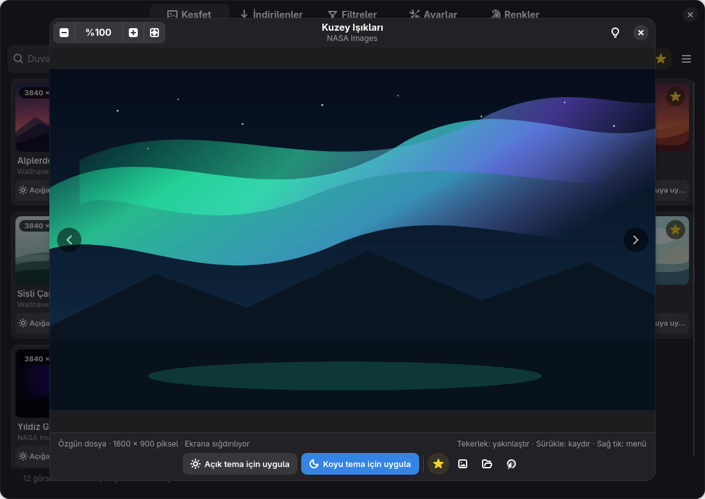
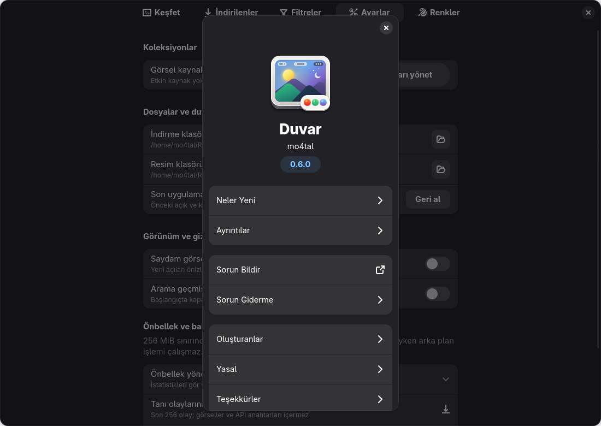

<div align="center">


# Duvar

**GNOME Shell 51 için çok kaynaklı duvar kâğıdı galerisi ve duvar kâğıdına uyarlanan OKLab renk motoru.**

*Multi-source wallpaper gallery & adaptive OKLab color engine built with Rust, GTK 4 and Libadwaita for GNOME Shell 51.*

[](https://github.com/mo4tal/duvar/actions/workflows/ci.yml)
[](https://github.com/mo4tal/duvar/releases)
[](https://extensions.gnome.org/)
[](Cargo.toml)
[](LICENSE)

[Hızlı Kurulum](#-hızlı-kurulum) · [Özellikler](#-öne-çıkan-özellikler) · [Kaynaklar](#-desteklenen-kaynaklar) · [Kaynaktan Derleme](#-kaynaktan-derleme) · [English Quick Start](#-english-quick-start)

<br />


</div>

---

## Neden Duvar?

Duvar, masaüstüne gereksiz panel ikonu, ayrı başlatıcı veya pencere kapalıyken çalışan arka plan servisi eklemez. **GNOME Uzantılar → Duvar → dişli** simgesinden doğrudan gerçek bir **Rust + GTK 4 + Libadwaita** penceresi açar; duvar kâğıdını seçtiğin anda açık ve koyu temana özel, okunabilirliği matematiksel olarak doğrulanmış renk paletlerini tüm GNOME Shell’e yansıtır.

---

## ✨ Öne Çıkan Özellikler

### 🎨 OKLab Renk Motoru ve Yüzen Cam Üst Panel Kapsülleri

Açık temada kapkara bir duvar kâğıdı veya koyu temada bembeyaz bir duvar kâğıdı kullandığında üst panel yazılarının kaybolması sorununu kökten çözer.

<div align="center">

</div>

- **16 dilimli üst şerit kontrast analizi:** Duvar kâğıdının üst kenarındaki parlaklık dağılımını ayrı ayrı ölçer; açık ve koyu duvar kâğıtlarını bağımsız olarak OKLab renk uzayında kümeleyerek baskın rengi çıkarır.
- **Yüzen cam kapsüller (`Yüzen kapsül` / `Akıllı` / `Üst perde` / `Sade`):** Hem açık hem koyu temada üst panel öğelerini ortam tonlu, zarif yarı saydam cam kapsüllerle sarar. Yoğunluk (`İnce cam`, `Dengeli cam`, `Belirgin cam`) canlı önizlemeyle anında ayarlanır.
- **User Themes olmadan da çalışır:** GNOME Shell stilini `St.Theme.load_stylesheet` üzerinden doğrudan yükler; User Themes açıksa onunla uyumlu çalışır.
- **10 palet karakteri & katmanlı uyum:** GNOME Shell, GTK 3/4, isteğe bağlı Libadwaita (`@media (prefers-color-scheme: dark)`), Blur My Shell uyumu ve isteğe bağlı Ghostty terminal senkronizasyonu (`integrations/`).

---

### 🔍 Loupe Tarzı Pro Önizleme (Lightbox)

<div align="center">

</div>

- **Anlık kademeli yükleme:** Önbellekteki küçük resim sıfır gecikmeyle ekrana gelir, arka planda özgün piksel çözünürlüğü akıcı biçimde yerine oturur.
- **Doğal fare ve dokunmatik kontrol:** Fare tekerleğiyle doğrudan imleç konumuna yakınlaştırma, sol tıkla sürükle-kaydır, dokunmatik kıstırma, `%100` / ekrana sığdır, sağ tık menüsü ve `←` / `→` ile kesintisiz gezinme.
- **Bağımsız açık/koyu hedefleme:** Tek tıkla yalnızca açık tema veya yalnızca koyu tema duvar kâğıdı olarak uygula; **Ayarlar → Geri al** ile önceki çifti anında geri getir.

---

### ⚡ Hız, Tasarım ve Güvenlik

| Alan | Uygulama Ayrıntısı |
| :--- | :--- |
| **6 Hatlı Rust Motoru** | 8 paralel LIFO küçük resim işçisi (kaydırmada görünür kart önceliği ve ekran dışı iptal), 2 bağımsız önizleme/üstveri işçisi, 2 indirme işçisi. |
| **Sıçramasız Sonsuz Kaydırma** | 180 öğelik bellek içi LRU önbelleği ve yerinde piksel boyama; indirme yaparken veya hızlı kaydırırken sayfanın başına atmaz. |
| **200 Aranabilir Kategori** | 100 genel + 100 hassas konu, Türkçe büyük/küçük harf uyumlu anlık arama, sunucu taraflı sıralama ve kaynak-filtre uyum bildirimi. |
| **Kapalı Başlayan Güvenlik** | İlk kurulum yalnızca **SFW** ile başlar. Şüpheli, yetişkin ve etiketsiz içerik izinleri ayrı anahtarlardadır; konu seçimi hassas izni otomatik açmaz. |
| **Sıfır Yan Dosya & Temiz Gizlilik** | Üstveriler yalnızca `~/.local/share/duvar/metadata/` altında saklanır; resim klasörüne JSON saçılmaz. Wallhaven API anahtarı yalnızca sistem anahtarlığında tutulur. |
| **Atomik Kurulum & Geri Dönüş** | `duvar-install` kurmadan önce SHA-256, mimari, GNOME 51 ve `dlopen` kontrolü yapar; her güncellemede tek komutla geri dönüş noktası bırakır. |

<details>
<summary><b>Duvar Hakkında penceresi ve yeni Adwaita simgesi</b></summary>
<br />
<div align="center">

</div>
</details>

---

## 🌐 Desteklenen Kaynaklar

Toplam **12 resmi kaynak** — belgesiz uç noktaları taklit etmez, hız sınırlarına (`Retry-After`) saygı gösterir:

- **Genel & Fotoğraf:** Wallhaven, Openverse, NASA Images, Bing Daily, Wikimedia Commons, Yerel Klasör
- **Açık Erişim Müzeler:** Cleveland Museum of Art (CC0), The Met (Public Domain), Victoria & Albert Museum (IIIF)
- **İllüstrasyon (varsayılan kapalı):** Yande.re, AIBooru, NekosAPI

Ayrıntılı kaynak sözleşmeleri ve güvenlik kuralları için: [docs/SOURCES.md](docs/SOURCES.md)

---

## 🚀 Hızlı Kurulum

### 1. Hazır Sürüm Paketiyle (Linux x86_64 · GNOME Shell 51)

[Releases](https://github.com/mo4tal/duvar/releases) sayfasından `duvar-0.6.0-linux-x86_64.tar.gz` arşivini indir, aç ve klasörde çalıştır:

```sh
sha256sum -c SHA256SUMS   # isteğe bağlı bütünlük doğrulaması
./duvar-install --check    # kurmadan önce sistem uyumluluk testi
./duvar-install            # sudo gerekmez, atomik kurulum + geri dönüş noktası
./duvar-doctor             # çevrimdışı kurulum sağlık kontrolü
```

Ardından **GNOME Uzantılar → Duvar** uzantısını etkinleştir ve dişli simgesine tıkla.
*(İlk kurulumda GNOME Shell’in yeni uzantıyı tanıması için bir kez oturumu kapatıp açman gerekebilir.)*

### 2. Sadece Renk Motoru (Saf-JS / EGO Mağaza Paketi)

Derlenmiş yerel kitaplık olmadan yalnızca dinamik renk ve üst panel kapsül motorunu kullanmak istersen:

```sh
bash distribution/pack-store.sh
gnome-extensions install --force dist/store/duvar@mo4tal.local.shell-extension.zip
```

---

## 🛠️ Kaynaktan Derleme

**Gereksinimler:** Rust ≥ 1.88, `pkg-config`, GTK 4 (≥ 4.12), Libadwaita (≥ 1.6), `g-ir-compiler`, `glib-compile-schemas`, `gnome-extensions`, `tar`, `unzip`.

```sh
git clone https://github.com/mo4tal/duvar.git
cd duvar
cargo build --release --locked
./target/release/duvar-package
./target/release/duvar-install --install dist/duvar@mo4tal.local.shell-extension.zip
```

### Doğrulama Testleri

```sh
cargo fmt --all --check
cargo clippy --locked --all-targets -- -D warnings
cargo test --locked --lib
gjs -m tests/palette-roles.js
bash tests/palette-worker.sh
python3 tests/run-preferences-smoke.py
bash tests/palette-shell-smoke.sh
```

---

## 📁 Proje Yapısı ve Dokümantasyon

- [AGENTS.md](AGENTS.md) — Geliştiriciler ve yapay zekâ asistanları için mimari harita, sürüm sözleşmesi ve değişmez kurallar
- [CHANGELOG.md](CHANGELOG.md) — Sürüm geçmişi ve yenilikler
- [docs/DISTRIBUTION.md](docs/DISTRIBUTION.md) — Ayrıntılı paketleme, dağıtım ve kurulum rehberi (TR / EN)
- [docs/SOURCES.md](docs/SOURCES.md) — 12 kaynak API sözleşmesi ve güvenlik politikası
- [integrations/](integrations/) — İsteğe bağlı Ghostty terminal palet senkronizasyonu (`ghostty-sync.py` + user systemd servisi)

---

## 🌍 English Quick Start

**Duvar** is a native **Rust + GTK 4 + Libadwaita** wallpaper gallery and **OKLab adaptive theme engine** for **GNOME Shell 51**. It runs directly inside GNOME’s extension preferences window with zero background daemons or tray icons, and keeps your top bar legible on any wallpaper with ambient-tinted floating glass capsules — even without User Themes.

```sh
# Prebuilt x86_64 release (no sudo, no Rust toolchain required):
tar -xzf duvar-0.6.0-linux-x86_64.tar.gz && cd duvar-0.6.0-linux-x86_64
./duvar-install && ./duvar-doctor

# Or build from source:
git clone https://github.com/mo4tal/duvar.git && cd duvar
cargo build --release --locked && ./target/release/duvar-package
./target/release/duvar-install --install dist/duvar@mo4tal.local.shell-extension.zip
```

Full bilingual distribution & packaging notes: [docs/DISTRIBUTION.md](docs/DISTRIBUTION.md).

---

<div align="center">
<sub>
<code>extension.js</code> ve <code>prefs.js</code> GNOME’un zorunlu GJS katmanıdır; galeri arayüzü, kaynak bağdaştırıcıları, filtreleme ve aktarım motoru Rust’tadır.<br />
<a href="https://github.com/Cookiiieee/WSelector">WSelector</a>’dan işlevsel olarak esinlenen, yapay zekâ destekli geliştirme (vibe coding) akışıyla tasarlanıp doğrulanmış bağımsız bir <a href="LICENSE">GPL-3.0-or-later</a> projesidir.
</sub>
</div>
