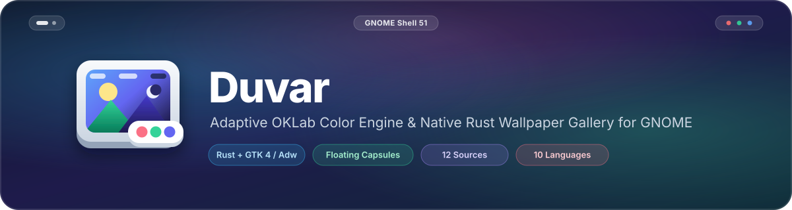
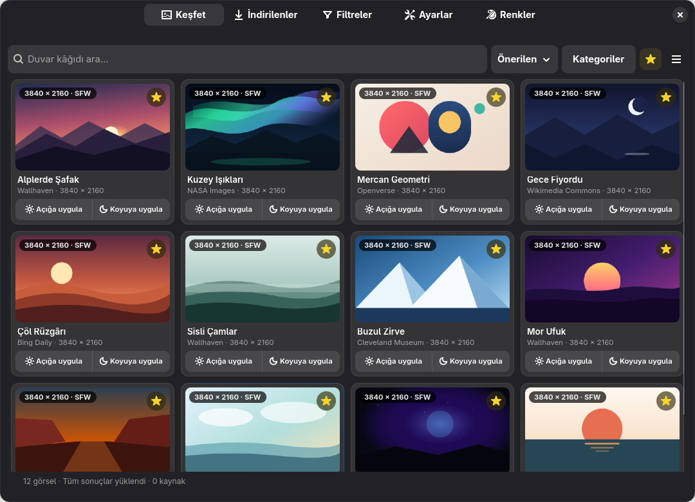
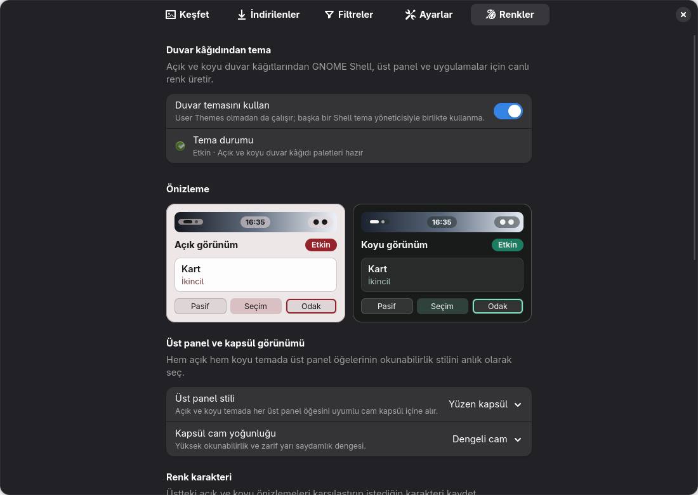
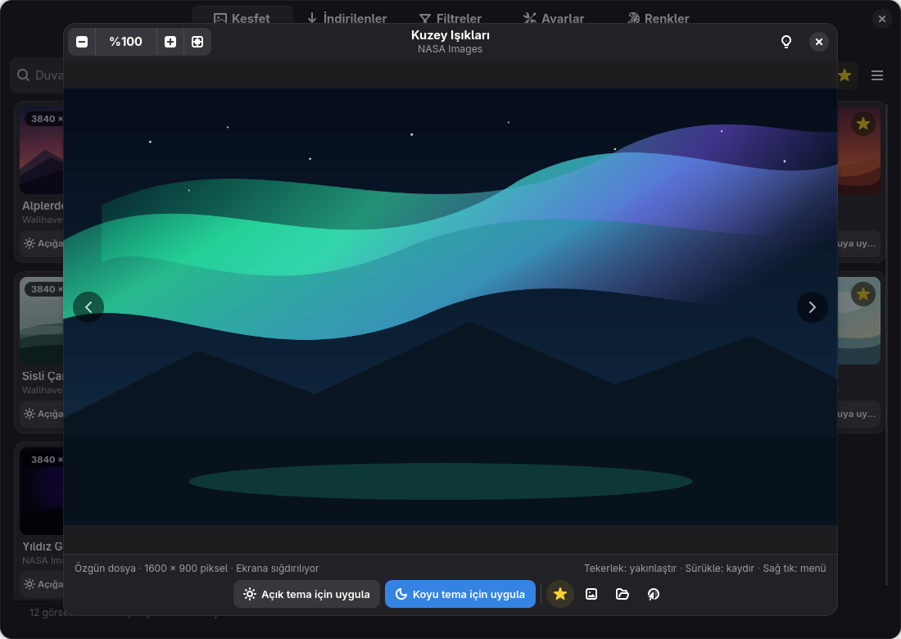
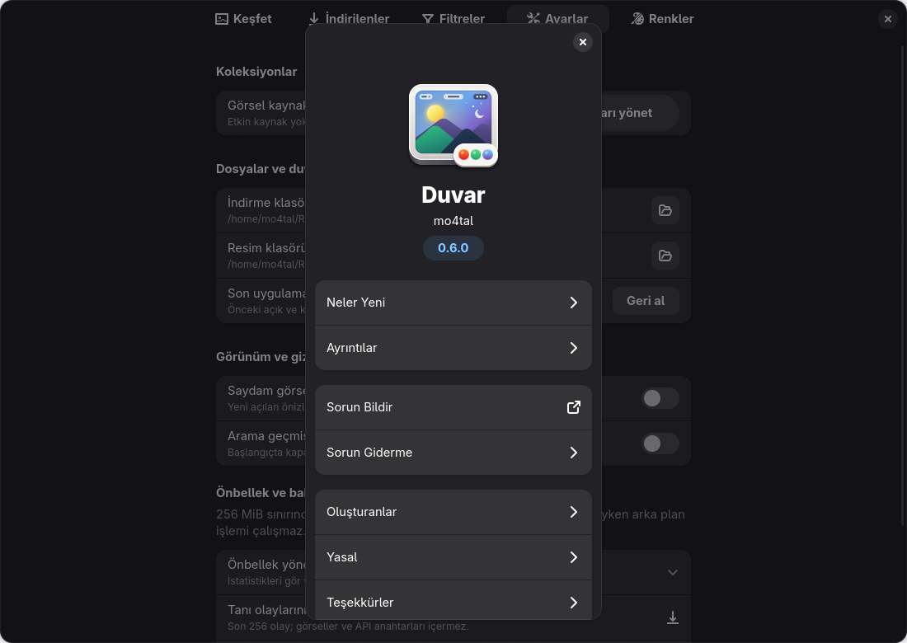

<div align="center">

<a href="https://github.com/mo4tal/duvar">
  
</a>

<br /><br />

[**English**](README.md) · **Türkçe**

<br />

[](https://github.com/mo4tal/duvar/actions/workflows/ci.yml)
[](https://github.com/mo4tal/duvar/releases)
[](https://extensions.gnome.org/)
[](Cargo.toml)
[](locales/README.md)
[](LICENSE)

<br />

[Hızlı Kurulum](#-hızlı-kurulum) · [Önerilen Masaüstü Kurulumu](#-önerilen-gnome-masaüstü-paketi) · [Özellikler](#-öne-çıkan-özellikler) · [Kaynaklar](#-12-resmi-kaynak) · [Diller](#-10-yerleşik-dil) · [Kaynaktan Derleme](#-kaynaktan-derleme)

</div>

<br />

> **Duvar**, GNOME’un kendi uzantı ayarları penceresi içine doğrudan gerçek bir **Rust + GTK 4 + Libadwaita** çok kaynaklı duvar kâğıdı galerisi ve **OKLab dinamik renk motoru** getirir. **Arka plan servisi yok**, **panel simgesi yok** ve hangi duvar kâğıdını seçersen seç üst paneli okunaklı tutan **yüzen cam kapsüller** var.

<br />

<div align="center">
  
</div>

<br />

---

## ✨ Öne Çıkan Özellikler

### 🎨 OKLab Renk Motoru ve Yüzen Cam Üst Panel Kapsülleri

Açık temada kapkara bir duvar kâğıdı ya da koyu temada bembeyaz bir duvar kâğıdı seçtiğinde üst panel yazılarının kaybolması sorununu kökten çözer.

<div align="center">
  
</div>

- **OKLab baskın renk kümeleme ve 16 dilimli üst şerit analizi:** Açık ve koyu duvar kâğıtlarını ayrı bir süreçte (`palette-worker.js`) inceleyerek üst panel boyunca parlaklık dağılımını ölçer.
- **Yüzen cam kapsüller:** Hem açık hem koyu temada üst panel öğelerini ortam tonlu, zarif cam kapsüller içine alır. **Yüzen kapsül**, **Akıllı kapsül**, **Üst perde** ve **Sade mürekkep** stilleri ile **Hafif / Dengeli / Belirgin** yoğunluk canlı önizlemeyle anında değişir.
- **User Themes olmadan da çalışır:** GNOME Shell stilini `St.Theme.load_stylesheet` üzerinden doğrudan uygular; User Themes veya Blur my Shell açıksa onlarla kusursuz uyumlu çalışır.
- **10 renk karakteri & katmanlı uyum:** GNOME Shell, GTK 3/4, isteğe bağlı Libadwaita (`@media (prefers-color-scheme: dark)`) ve isteğe bağlı Ghostty terminal temaları (`integrations/`).

<br />

### 🔍 Loupe Tarzı Pro Önizleme (Lightbox)

<div align="center">
  
</div>

- **Anlık kademeli açılış:** Önbellekteki küçük resim sıfır gecikmeyle ekrana gelir, özgün piksel çözünürlüğü arka planda pürüzsüzce yerine oturur.
- **Doğal inceleme deneyimi:** Fare tekerleğiyle doğrudan imlece yakınlaştırma, sol tıkla sürükle-kaydır, dokunmatik kıstırma, `%100` / ekrana sığdır, sağ tık menüsü, `←` / `→` gezinme ve açılır bilgi/etiket çekmecesi (`I`).
- **Bağımsız açık/koyu hedefleme:** Tek tıkla yalnızca açık veya yalnızca koyu tema duvar kâğıdı olarak uygula; **Ayarlar → Son uygulamayı geri al** ile önceki çifti anında geri getir.

<br />

### ⚡ Hız, Gizlilik ve Adwaita Minimalizmi

<table>
  <tr>
    <td width="50%" valign="top">
      <h4>🚀 6 Hatlı Paralel Rust Motoru</h4>
      8 LIFO küçük resim işçisi (görünür kartlara öncelik ve kaydırınca iptal), 2 bağımsız önizleme işçisi, 2 indirme işçisi, 180 öğelik bellek içi LRU önbelleği ve kaydırma konumunu hiç sıçratmayan yerinde boyama.
    </td>
    <td width="50%" valign="top">
      <h4>🔒 Kapalı Başlayan Güvenlik & Temiz Disk</h4>
      İlk kurulum yalnızca <b>SFW</b> ile başlar. Hassas izinler ayrı anahtarlardadır. Üstveriler yalnızca <code>~/.local/share/duvar/metadata/</code> içinde tutulur; resim klasörüne JSON saçılmaz. Wallhaven anahtarı yalnızca sistem anahtarlığında saklanır.
    </td>
  </tr>
  <tr>
    <td width="50%" valign="top">
      <h4>🧭 200 Aranabilir Kategori & Dürüst Sıralama</h4>
      100 genel + 100 hassas konu, Türkçe büyük/küçük harf uyumlu anlık arama, destekleyen kaynaklarda gerçek sunucu taraflı sıralama ve şeffaf kaynak-filtre uyum bildirimi.
    </td>
    <td width="50%" valign="top">
      <h4>🛡️ Ön Denetim ve Atomik Geri Dönüş</h4>
      <code>duvar-install</code> kurmadan önce SHA-256, mimari, GNOME 51, GTK/Adwaita ve <code>dlopen</code> denetimi yapar; her güncellemede tek komutla geri dönüş noktası bırakır.
    </td>
  </tr>
</table>

<details>
<summary><b>Yenilenen Ayarlar ve Duvar Hakkında penceresini görüntüle</b></summary>
<br />
<div align="center">
  
</div>
</details>

<br />

---

## 🚀 Hızlı Kurulum

### Seçenek 1 — Hazır Sürüm Paketi *(Önerilen · Linux x86_64 · GNOME 51)*

[**GitHub Releases**](https://github.com/mo4tal/duvar/releases) sayfasından `duvar-0.6.0-linux-x86_64.tar.gz` arşivini indir, aç ve çalıştır:

```sh
sha256sum -c SHA256SUMS   # isteğe bağlı bütünlük kontrolü
./duvar-install --check    # kurmadan önce uyumluluk testi
./duvar-install            # sudo gerekmez, atomik kurulum + geri dönüş noktası
./duvar-doctor             # çevrimdışı sağlık denetimi
```

Ardından **GNOME Uzantılar → Duvar** uzantısını etkinleştir ve dişli simgesine tıkla.

### Seçenek 2 — Yalnızca Renk Motoru *(Derlenmiş Kitaplıksız Saf-JS)*

```sh
gnome-extensions install --force duvar-0.6.0-pure-js-store.shell-extension.zip
```

<br />

---

## 🧩 Önerilen GNOME Masaüstü Paketi

Duvar’ın cam kapsülleri ve uyarlanabilir renk motoruyla en iyi uyumu veren 5 uzantıyı **tek komutla**, **sudo gerektirmeden** ve **otomatik yedekli/geri alınabilir** biçimde kurup dinamik olarak yapılandırabilirsin:

1. **Duvar** (`duvar@mo4tal.github.io`) — OKLab renk motoru + dengeli yüzen cam kapsüller + GTK/Adwaita uyumu
2. **Blur my Shell** (`blur-my-shell@aunetx`) — dinamik Dual-Kawase bulanıklık, gradyan üst panel, yuvarlatılmış bulanık açılır menüler ve pencereler
3. **User Themes** (`user-theme@gnome-shell-extensions.gcampax.github.com`) — Shell tema katmanı
4. **User Avatar In Quick Settings** (`quick-settings-avatar@d-go`) — Hızlı Ayarlar’da çerçevesiz kullanıcı profil başlığı
5. **Rounded Window Corners Native** (`rounded-window-corners@ztrahmet.github.io`) — Libadwaita ve `gtk.css` ile dinamik uyumlu yuvarlatılmış pencere köşeleri

```sh
# Önce hiçbir şeyi değiştirmeden nelerin yapılacağını gör:
curl -fsSL https://raw.githubusercontent.com/mo4tal/duvar/main/scripts/setup-recommended-desktop.sh | bash -s -- --dry-run

# Kurulumu ve dinamik ön ayarları uygula (mevcut dconf ayarların otomatik yedeklenir):
curl -fsSL https://raw.githubusercontent.com/mo4tal/duvar/main/scripts/setup-recommended-desktop.sh | bash
```

> **Güvenlik garantisi:** `sudo` istemez, hiçbir kişisel veri/token/kullanıcı adı içermez, mevcut diğer uzantılarına dokunmaz ve `--rollback <yedek-klasörü>` ile tek komutta geri alınır. İncele: [scripts/setup-recommended-desktop.sh](scripts/setup-recommended-desktop.sh).

<br />

---

## 🌐 12 Resmi Kaynak

- **Fotoğraf & Genel:** Wallhaven, Openverse, NASA Images, Bing Daily, Wikimedia Commons, Yerel Klasör
- **Açık Erişim Müzeler:** Cleveland Museum of Art (CC0), The Met (Public Domain), Victoria & Albert Museum (IIIF)
- **İllüstrasyon *(varsayılan kapalı)*:** Yande.re, AIBooru, NekosAPI

Ayrıntılı kaynak sözleşmeleri: [**docs/SOURCES.md**](docs/SOURCES.md)

<br />

---

## 🌍 10 Yerleşik Dil

Duvar varsayılan olarak **Türkçe (`tr`)** açılır ve **Ayarlar → Görünüm ve gizlilik → Uygulama dili** üzerinden **10 dili** destekler:

`Türkçe (Varsayılan)` · `English` · `Español` · `Deutsch` · `Français` · `Português (Brasil)` · `Русский` · `日本語` · `简体中文` · `العربية`

Tüm metinler tek bir düzenli klasörde — [**`locales/`**](locales/README.md) — toplanmıştır; her metnin hangi ekranda, dosyada ve bileşende yer aldığı [**`locales/CONTEXT.md`**](locales/CONTEXT.md) içinde belgelenmiştir ve CI tarafından otomatik doğrulanır.

<br />

---

## 🛠️ Kaynaktan Derleme

**Gereksinimler:** Rust ≥ 1.88, `pkg-config`, GTK 4 (≥ 4.12) ve Libadwaita (≥ 1.6) geliştirme paketleri, `g-ir-compiler`, `glib-compile-schemas`, `gnome-extensions`, `tar`, `unzip`.

```sh
git clone https://github.com/mo4tal/duvar.git
cd duvar
cargo build --release --locked
./target/release/duvar-package
./target/release/duvar-install --install dist/duvar@mo4tal.github.io.shell-extension.zip
```

---

## 📁 Dokümantasyon ve Mimari

| Belge | Amaç |
| :--- | :--- |
| [**AGENTS.md**](AGENTS.md) | Geliştiriciler ve yapay zekâ asistanları için tam mimari harita ve kurallar |
| [**locales/CONTEXT.md**](locales/CONTEXT.md) | Her metnin ekran, dosya ve bileşen bağlamını gösteren çeviri haritası |
| [**docs/DISTRIBUTION.md**](docs/DISTRIBUTION.md) | Ayrıntılı paketleme, doğrulama ve EGO mağaza rehberi (TR / EN) |
| [**docs/SOURCES.md**](docs/SOURCES.md) | 12 kaynak API sözleşmesi ve güvenlik politikası |
| [**CHANGELOG.md**](CHANGELOG.md) | Sürüm geçmişi ve yenilikler |
| [**integrations/**](integrations/) | İsteğe bağlı Ghostty terminal palet senkronizasyonu (`ghostty-sync.py` + systemd servisi) |

---

<div align="center">
<sub>
<code>extension.js</code> ve <code>prefs.js</code> GNOME’un zorunlu GJS katmanıdır; galeri arayüzü, kaynak bağdaştırıcıları, filtreleme, önbellek ve aktarım motoru Rust’tadır.<br />
<a href="https://github.com/Cookiiieee/WSelector">WSelector</a>’dan işlevsel olarak esinlenen, yapay zekâ destekli geliştirme (vibe coding) akışıyla tasarlanıp doğrulanmış bağımsız bir <a href="LICENSE">GPL-3.0-or-later</a> projesidir.
</sub>
</div>
